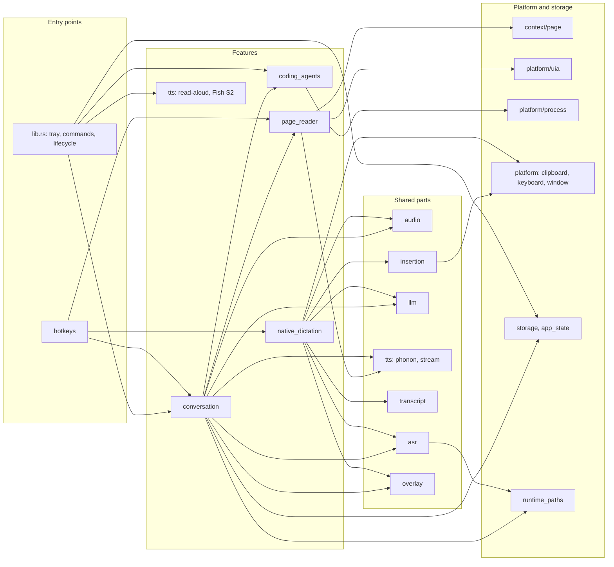
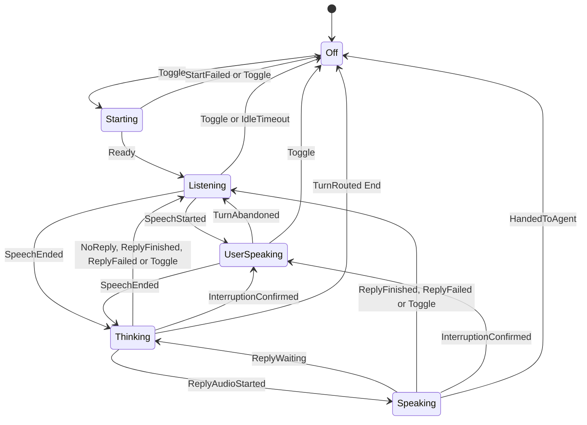
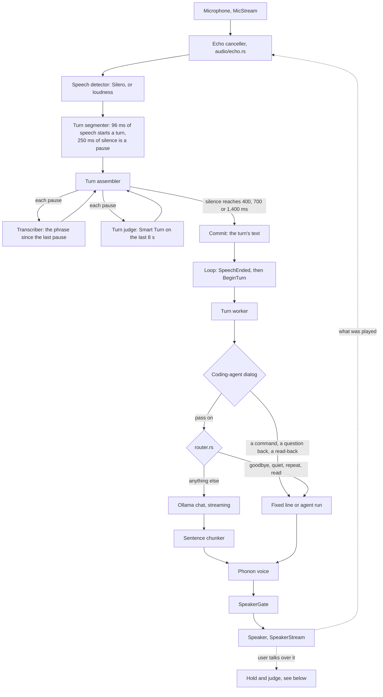
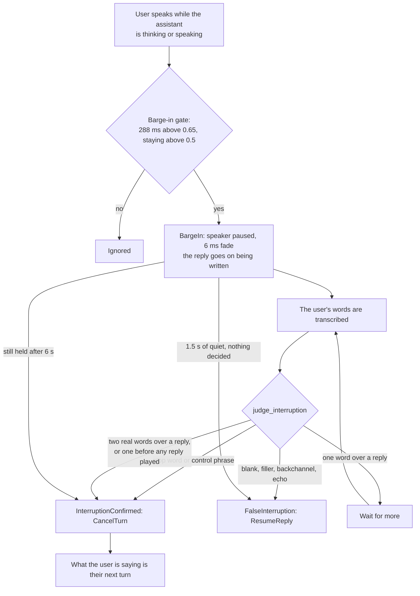
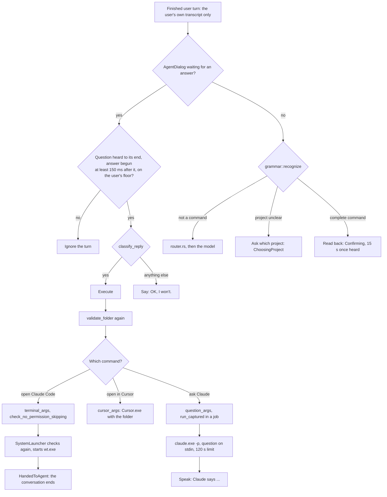

# Architecture

LocalFlow is a Tauri 2 app. The Rust native layer in `src-tauri` owns everything that touches
audio, models, hotkeys, other windows and other programs. The React web UI in `src` is the
settings window and the overlay; it shows state and edits settings, and it can only reach
the native layer through declared Tauri commands.

Four features share the native parts: dictation, conversation, reading a window aloud, and
voice commands for coding agents. The user-facing description is in
[USER_GUIDE.md](USER_GUIDE.md); this document is about how the code is arranged.

## Module map



## Native modules

- `hotkeys`: global hotkeys through Tauri's global-shortcut plugin. Dictation registers both
  `Ctrl+Alt+Space` and `Ctrl+Alt+Shift+Space`; conversation (`Ctrl+Alt+T`) and reading
  (`Ctrl+Alt+R`) each try the plain combination first and the `Shift` variant only if it is
  taken. `Escape` is registered only while a dictation records. Dictation is ignored during
  a conversation, and the conversation and reading hotkeys check the other modes, so only
  one thing uses the microphone or the speaker.
- `native_dictation`: the live dictation coordinator (see
  [Dictation pipeline](#dictation-pipeline)). `mod.rs` has the recorder loop, the level meter
  and the transcribe, format and paste worker. `gesture.rs` decides what each hotkey and
  level-meter event means (tap or hold). `session.rs` holds `SessionRegistry` (session
  identity and the supersede/cancel guard), `recovery.rs` the last transcript for "Copy last
  transcript" and the "not pasted" notice, `messages.rs` every line dictation shows, and
  `latency.rs` the per-dictation timings. The worker revalidates the session before every
  side effect, so a superseded or cancelled session never pastes.
- `workflow`: an explicit dictation state machine. It is exercised only by the mock-session
  commands, which exist only in debug builds, not by the live hotkey path; see the archived
  [REPO_AUDIT.md](archive/REPO_AUDIT.md) §2.
- `audio`: `capture.rs` (dictation's `cpal` input, one locked channel), `vad.rs` (dictation's
  loudness end-of-speech detector, with the wait from settings clamped to 300-3000 ms),
  `resample.rs` (band-limited resampling to 16 kHz, plus a stateful `StreamResampler`),
  `wav.rs`, `spectrum.rs` (the overlay's analyser), and the conversation parts: `devices.rs` (`MicStream`, `SpeakerStream`), `ring.rs`, `echo.rs`,
  `speech_detector.rs`, `turn_segmenter.rs` and `smart_turn.rs`.
- `asr`: the speech-to-text boundary and its engines (see [Speech recognition](#speech-recognition)).
  `streaming.rs`, `stabilizer.rs` and `windows.rs` are an unused streaming foundation kept for
  later work; only their tests run.
- `llm`: `ollama.rs` (the loopback-only client: no proxy, no redirects, cloud models refused
  (see [Ollama models that run elsewhere](#ollama-models-that-run-elsewhere)), one fixed
  `num_ctx` of 4096 so the model is never reloaded between callers), `cleanup.rs` (dictation
  clean-up: prompt, strict JSON contract, one repair attempt) and `chat.rs` (`ChatProvider`
  and the streaming, cancellable `OllamaChat` for conversation).
- `transcript`: the authoritative deterministic formatting for dictation: spoken
  punctuation, explicit self-corrections, filler and stutter removal, capitalisation, the
  user's replacements and snippets, and URL, email and decimal protection.
- `insertion`: `target.rs` (the window and the control focused when dictation started, and
  the fail-closed check before pasting) and `clipboard_paste.rs` (the delayed-rendering
  clipboard write, `Ctrl+V`, and putting the earlier clipboard back once the target has read
  the text).
- `conversation`: the conversation engine (see [Conversation engine](#conversation-engine)).
- `tts`: voices (see [Voices](#voices)).
- `context`: `context/page` is the page model for reading aloud; `context/mod.rs` is the
  older, unused context snapshot interface.
- `page_reader.rs`: reading a window aloud (see [Reading a window aloud](#reading-a-window-aloud)).
- `coding_agents`: voice commands for coding agents (see [Coding agents](#coding-agents)).
- `platform`: `uia/` (UI Automation on a dedicated thread), `process.rs` (child processes in
  kill-on-close job objects), `clipboard.rs` (delayed rendering and the privacy markers other
  programs set), `keyboard.rs` (whether a modifier key is physically down), `window.rs`
  (integrity levels and Remote Desktop detection) and `show_message_box`. AGENTS.md asks for
  platform code to live here; Win32 calls in `asr/sidecar.rs` and `overlay.rs` still sit
  outside it.
- `overlay.rs`: the floating overlay window: phase and audio-feature events on
  `localflow://native-dictation`, show and hide with the auto-hide timer, and placement above
  the taskbar.
- `runtime_paths.rs`: where binaries and models are looked for: `localflow-runtime` in the
  packaged resources (next to `localflow.exe` on Windows), then the per-user folder
  `%LOCALAPPDATA%\LocalFlow`, then, only with the `dev-runtime` feature that local builds turn
  on, `.localflow-runtime/` in the source checkout. Release builds are built without that
  feature, so they carry no build-machine path and start programs only from the first two.
  Its "missing" messages name files and scripts, never folders.
- `readiness.rs`: the `readiness_status` checklist (see [Readiness](#readiness)).
- `storage`: the SQLite schema, the settings row and start-up recovery (`mod.rs`), the log
  file (`log_file.rs`) and `redact_user_paths` (`redact.rs`). `app_state.rs`: settings
  structs, the lenient `parse_settings`, and the `LocalFlowRuntime` state. `privacy`:
  redaction helpers. `cancel.rs`: the shared `CancelFlag`. `desktop_health.rs`: the health
  file (see [App lifecycle](#app-lifecycle)).
- `lib.rs`: start-up, the tray, the command list, and the lifecycle (see
  [App lifecycle](#app-lifecycle)).

## Dictation pipeline

```text
hotkey press -> speech engine installed? (files only) -> foreground window and focused control
    -> capture (cpal, one locked channel) -> gesture.rs: tap (hands-free) or hold
    -> stop: tap: End-of-speech silence; hold: release; either: 120 s
    -> band-limited resample to 16 kHz -> speech-to-text through the provider chain
       (dictionary terms bias the recogniser)
    -> deterministic formatting (transcript), seeded from the user's replacements and snippets
    -> transcript kept for recovery -> modifiers released (up to 1 s)
    -> session, window, focused control and integrity checks -> delayed-rendering paste
    -> earlier clipboard put back once the target has read the text
    -> background Ollama clean-up (its result only replaces the recoverable last transcript)
```

Threads: one recorder loop (`localflow-dictation`) owns the microphone and handles every
hotkey and level-meter event in order; a level meter per recording feeds the overlay (about
36 frames a second) and the end-of-speech detector; a worker per finished recording
transcribes, formats and pastes. The loop and the workers run under `catch_unwind`: a panic
resets dictation and tells the user, and a dead loop is restarted by the next hotkey event.

`start_recording` checks that a speech engine is installed before the microphone opens
(`check_speech_engine`, files only), so a missing model is reported at the press. It also
stops read-aloud and page reading, which the microphone would otherwise record.

### Tap or hold

`gesture.rs` is a pure function, `decide(input, active recording, time since the last
automatic stop)`:

- A press starts a recording with the key counted as held. A release within `QUICK_TAP_MS`
  (700 ms) makes it hands-free; a later release finishes it (push-to-talk).
- Hands-free, the level meter finishes it after `microphone.end_of_speech_ms` of silence
  (900 ms by default, clamped to 300-3000 ms by `vad::end_of_speech_timeout`) once speech
  was seen and at least 350 ms in, and discards it after 2.5 s without speech. A second press
  finishes it if it comes at least 700 ms after the start; an earlier one is ignored.
- While the key is held the meter sends no silence stops (and `decide` ignores any); only the
  release or the 120 s maximum ends it.
- A press within `AFTER_AUTO_STOP_IGNORE_MS` (700 ms) of an automatic stop is ignored: it was
  almost certainly meant to stop the recording that had just stopped itself, and starting a
  new one would supersede the dictation being transcribed.
- `Escape` cancels.

### Before the paste

The worker, in order:

1. Transcribes and formats. A cancelled session stops here. The text is stored in
   `Recovery`, which orders transcripts by session id, so a late worker never replaces a
   newer dictation's text.
2. A superseded session (a newer recording started) stops too and is marked unpasted. The
   recorder shows "Previous dictation was not pasted" once no recording or worker owns the
   overlay, and only while that transcript is still the one "Copy last transcript" returns.
3. `keyboard::wait_for_modifiers_released` waits up to 1 s: the global-shortcut plugin
   reports the release when Space comes up, and a `Ctrl+V` sent with `Alt` still down would
   arrive as `Ctrl+Alt+V`. Still held: `KEYS_STILL_HELD`, no paste.
4. The session is checked again.
5. `target_matches`: the foreground window, its process and the control holding the keyboard
   focus (`GUITHREADINFO::hwndFocus`) must all equal what was captured at the press. A focus
   that could be read at one end and not the other counts as changed. Otherwise
   `FOCUS_CHANGED`, no paste. Only controls that are windows of their own are told apart:
   every field of a web page, or of a program that draws its own controls, has the same
   `hwndFocus`.
6. `window::input_blocked_for_process`: Windows silently drops synthetic input to a window of
   a higher integrity level (an administrator window when LocalFlow is not one), so
   `ELEVATED_TARGET` is shown instead of a false "Inserted". A level that cannot be read is
   not treated as blocked.

### The clipboard

- `read_previous_clipboard` keeps plain text for the restore. Content with a privacy marker
  (`ExcludeClipboardContentFromMonitorProcessing`, `Clipboard Viewer Ignore`, or
  `CanIncludeInClipboardHistory` / `CanUploadToCloudClipboard` set to anything but 1, or
  present and unreadable) is never read and is cleared afterwards, never restored. Text
  LocalFlow itself put back is recognised by the clipboard sequence number.
- `DelayedText` (`platform/clipboard.rs`) announces the text with delayed rendering from a
  hidden message-only window on its own thread, with the clipboard-history and cloud-sync
  exclusions. The first `WM_RENDERFORMAT` tells LocalFlow that the text was fetched, and by
  which process.
- `restore_due` puts the earlier text back 300 ms after the target fetched it; 1 s after the
  paste (or 300 ms after the fetch, if later) when another process fetched it first; 3 s
  after the paste when nothing fetched it; and never sooner than 400 ms after the paste.
  When `GetSystemMetrics(SM_REMOTESESSION)` says LocalFlow runs in a Remote Desktop session
  these are 600 ms, 3 s, 8 s and 2 s.
- If something else was copied in the meantime it is left alone. Restored text carries the
  exclusions too, so a restore never adds a clipboard-history entry. If delayed rendering
  cannot be set up, the text is placed directly and restored after the fixed delay. A new
  paste first finishes a restore still waiting from the previous one.
- Images and other formats are not restored; the clipboard is cleared instead.

The last transcript is kept in memory only, for "Copy last transcript", which uses the same
exclusions.

## Conversation engine

A hotkey switches on a hands-free conversation with the local language model. The engine is
in `src-tauri/src/conversation`, written against traits (audio source and sink, speech
detector, speech-to-text, chat model, voice, turn model, coding agents, page source) so the
whole lifecycle is tested with scripted audio and fake models. `conversation/mod.rs` supplies
the real devices and models and connects the engine to the hotkey, the tray, the overlay and
the settings window.

| File                 | Role                                                                                           |
| -------------------- | ---------------------------------------------------------------------------------------------- |
| `state.rs`           | The turn-taking state machine: a pure function from (state, event) to (state, effects).        |
| `engine.rs`          | The threads: the loop, the ear, the transcriber, the turn judge and one worker per turn.       |
| `assembler.rs`       | Decides which pause ends the turn, from what the recogniser and the turn model returned. Pure. |
| `turn_completion.rs` | The text judge: complete, incomplete or unsure, from the words. English, rule-based.           |
| `barge_in.rs`        | Judges speech over a held reply: a real interruption, a backchannel or an echo. Pure.          |
| `echo_guard.rs`      | Whether a transcript is a stretch of what the assistant was saying.                            |
| `router.rs`          | Fixed control phrases, matched before any model sees the turn.                                 |
| `agents.rs`          | The conversation's side of the coding-agent commands.                                          |
| `chunker.rs`         | Cuts the streamed reply into speakable pieces and removes markup.                              |
| `speaking.rs`        | Speaks a sequence of pieces; `SpeakerGate` decides which turn's reply may use the speaker.     |
| `memory.rs`          | The bounded, in-memory, turn-ordered history sent to the model.                                |

### Threads

- The **loop** owns `ConversationState`, applies events through `state::transition`, and
  carries out the effects it returns.
- The **ear** reads the microphone for the whole conversation. It runs the echo canceller,
  the speech detector, the segmenters and the turn assembler, sends phrases to the
  **transcriber** thread and pauses to the **turn judge** thread, enforces the time limits,
  and holds or releases replies.
- A **turn worker** per user turn decides what the turn is and produces the reply: a fixed
  line, page text, a coding-agent command, or the model's streamed answer through the voice
  into the speaker. The model streams into the voice and the voice into the speaker, so the
  first sentence is heard while later ones are still being written.

Events carry the conversation or turn number they belong to. The ear hands a finished turn
to the loop by number (`Message::TurnEnded { utterance }`), not through a shared slot.

### State machine



`MaxDuration`, `DeviceLost` and `EndRequested` (app exit) end a conversation from any phase.
Ending cancels the current turn and bumps the turn number, so anything still in flight is
ignored.

`held` is a flag on `Thinking` and `Speaking`. `BargeIn` sets it and emits `PauseReply`;
`FalseInterruption` clears it and emits `ResumeReply`; `InterruptionConfirmed` clears it and
emits `CancelTurn`. Whatever ends a hold, `transition` adds a `ResumeReply` after any
`CancelTurn`, so the speaker is never left paused and nothing cancelled is heard.

The hotkey (`Toggle`) interrupts while the assistant has the floor (`Thinking`, `Speaking`)
and ends the conversation otherwise. `ReplyWaiting` returns to `Thinking` while a
coding-agent question runs, so the microphone is listened to as while any reply is
prepared.

### The ear's stages

The ear keeps its own view of who has the floor (`Stage` in `engine.rs`):

- `Closed`: not acting on the microphone until the floor is first given to the user.
- `User`: the user has the floor; the assembler is finding the start and end of their turn.
  It records whether the turn began over a reply (`over_reply`, so it might be the
  assistant's echo) and whether it began on the user's own floor (`own_floor`, the only kind
  of turn that may answer a coding-agent read-back). `continues` holds the earlier text when
  the user carried on before the reply to it was heard.
- `Assistant`: a turn was handed over and the assistant has the floor. Only the start of
  speech over it is watched for, through the stricter barge-in segmenter.
- `Holding`: the user started speaking over the assistant and the reply is held while their
  words are judged.

The microphone is ignored for 300 ms after the assistant stops speaking (`reopen_guard`), so
the last of its own voice is not taken for the user.

### Turn flow



While the user speaks, the engine sends Ollama a one-token request about every 400 ms
(`ChatProvider::keep_warm`), so a laptop GPU has not dropped to its lowest power state by the
time the question is ready ([benchmark](benchmarks/CONVERSATION_BENCHMARK.md)).

### Turn assembler and the two turn judges

`assembler.rs` is pure and counts time in audio samples. At each 250 ms pause it asks for
the speech not yet transcribed to be transcribed. If the user carries on, that text is kept
and only what follows is sent at the next pause, so a long turn costs no more than its last
phrase. Once everything said is transcribed, the silence needed to end the turn depends on
`Readiness`: 400 ms when ready, 700 ms when unsure, 1.4 s when not ready.

Two judges set the readiness:

- The **text judge** (`turn_completion.rs`, `default_readiness` in `conversation/mod.rs`)
  reads the transcript. It returns complete only on positive evidence, treats punctuation as
  weak evidence (the recogniser puts full stops where the speaker only took a breath), and
  says unsure when in doubt.
- **Smart Turn** (`audio/smart_turn.rs`), Pipecat's v3.2 model, hears the voice. It runs
  in-process through `tract` (pure Rust, pinned to 0.23.10) on its own thread, beside the
  recogniser, on the last 8 s of the turn. Only the full-precision `smart-turn-v3.2-gpu.onnx`
  is used: the 8-bit `-cpu` file gives wrong answers in `tract`.

`combined_readiness` combines them. The voice decides and the words move it one step:

| Smart Turn says                  | Words: ready | Words: unsure | Words: not ready |
| -------------------------------- | ------------ | ------------- | ---------------- |
| Finished (probability above 0.5) | Ready        | Ready         | Unsure           |
| Not finished                     | Unsure       | Not ready     | Not ready        |
| Still listening to this pause    | Unsure       | Unsure        | Not ready        |
| No model, or it failed           | Ready        | Unsure        | Not ready        |

On Smart Turn's public test set this cut the share of unfinished turns ended too early from
28.4 % (text judge alone) to 4.5 %, with finished turns answered slightly sooner
([benchmark](benchmarks/TURN_JUDGE_BENCHMARK.md)). An answer belongs to one pause: if the user
speaks again it is discarded, and a late answer for an earlier pause is ignored. Without the
model file, `best_turn_model` returns none and the words decide alone.

### Talking over a reply: hold and resume

Speech over the assistant goes through a second, stricter segmenter: it must start above
0.65, stay above 0.5 (short dips of up to 32 ms pause the count rather than reset it) and
last 288 ms, against 0.5 and 96 ms for an ordinary start of turn. Then the reply is held,
not cancelled (LiveKit Agents' "false interruption"). `barge_in.rs` judges the words as they
are transcribed.



- **Real**: a stop word ("stop", "wait", "no", "hold", "cancel", ...), a control phrase from
  `router.rs` (end, quiet, repeat, and the reading moves: from the top, next, previous,
  again; not "read this page" and its kin), or at least two words that are neither fillers
  nor the assistant's own.
- **Backchannel**: nothing, fillers, or an acknowledgement ("mm-hmm", "yeah", "okay", "got
  it", "go on", "keep reading").
- **Echo**: `echo_guard::is_echo_of` or a fragment of the reply being spoken.
- The two-word minimum applies only while the reply is audible (Pipecat). Speech that began
  while the reply was still being prepared is the user carrying on, and one word of substance
  is enough; that turn's earlier text becomes `continues`, and the two are sent to the model
  as one message (`ConversationMemory::push_user_continuing`). This is how "read this page"
  followed by "from the top" becomes one command.
- While a coding-agent question runs, a hold uses `judge_while_agent_works` instead: only
  "stop that" and its synonyms stop the agent; other speech gets a reminder; a long hold
  resumes rather than cancels, so a minute's work is not lost to a remark. The question is
  registered as a job before "Asking Claude..." is spoken, so talking over that line cannot
  cancel the confirmed question. Once the answer is in, the hold switches to the ordinary
  rules (`HeldReply::agent_finished`), and "stop that" then stops the answer being spoken.

`AudioSink::pause` fades the speaker out over 6 ms and stops reading the queue; held audio is
never counted as played, so it is never counted as heard. `resume` fades back in.

### Not answering itself

Three layers keep the assistant's own voice from counting as the user:

1. **Echo cancellation** (`audio/echo.rs`): a pure-Rust port of the WebRTC AEC3 canceller
   (`sonora`, pinned to 0.3.0). The speaker reports exactly what it played
   (`AudioSink::take_played`) as the reference. When the microphone is far quieter than the
   speaker, because the audio driver already removes it, the canceller detects this and
   passes the microphone through. It adds about 28 ms of delay.
2. **The stricter barge-in gate** above.
3. **The transcript check**: an interruption whose words are a stretch of what was being
   said is an echo (`echo_guard.rs`).

If the canceller cannot be built, the pass-through `NoEchoCancellation` is used, the ear
ignores the microphone while the assistant speaks, and interrupting is by hotkey only.

### Turn numbers, the speaker gate and memory

- **Turn numbers.** `turn` changes for every user turn and every interruption, and
  `conversation` every time the mode is switched on. A late result from a cancelled turn or
  a closed conversation no longer matches and is ignored.
- **The speaker gate.** Each reply speaks through its own gated sink (`SpeakerGate` in
  `speaking.rs`). Cancelling a turn closes the gate to it and silences the queue in one step,
  so a cancelled reply that is slow to notice cannot play over, flush, or cut off the reply
  after it. `speak_pieces` reports how many pieces were heard to the end
  (`Spoken::finished_pieces`), which is how a page's reading position and the memory advance
  only as far as the user heard.
- **Turn-ordered memory.** `ConversationMemory` keeps each entry with its turn number and in
  turn order, however late it is recorded: an interrupted reply is recorded when it stops,
  which can be after the user's next words, and still goes before them. Only what was heard
  of a reply is kept. History is bounded to 8,000 characters to fit the 4,096-token context,
  trimmed rather than summarised, and cleared when the conversation ends. The system prompt
  is kept byte-for-byte stable so Ollama can reuse its cached evaluation.

### Limits and rules

- 45 s of silence while listening ends a conversation, as do 10 minutes in total and a
  microphone that errors or delivers nothing for 3 s. One turn is cut at 60 s.
- The language model has no tools. Control phrases and coding-agent commands are matched in
  code on the user's own transcript before the model is asked; the model's output is only
  spoken.
- Nothing said is logged or stored. `Notice` carries phases, fixed messages, counts and
  timings; tests check that no transcript, reply or page text appears in notices or in the
  next model request.

## Speech recognition

`src-tauri/src/asr`:

- `provider.rs`: `SpeechToTextProvider` (mono 16 kHz samples, a language and an optional
  vocabulary prompt in; text and the engine's name out), the typed `AsrError`, the
  per-utterance deadline, and `FallbackProvider`. A failure falls back to another local
  engine, never a remote one.
- `transcribe_cpp.rs`: the in-process engine for GGUF models (Parakeet TDT 0.6B v3) through
  the `transcribe-cpp` crate. The model is loaded once and kept; a watchdog cancels a run that
  passes its deadline through the library's abort callback; a failed run drops the session so
  the next one reloads it. Its native logging is off and it opens no socket.
- `whisper_server.rs`: a supervised persistent `whisper-server.exe` on `127.0.0.1` with an
  ephemeral port, in-memory WAV, restart on exit, deadline kill, start back-off and a check
  that the listener belongs to the process LocalFlow started.
- `whisper_cli.rs`: one `whisper-cli.exe` process per utterance; the fallback and
  low-resource engine.
- `sidecar.rs`: hidden-process launch, the kill-on-close job object and memory measurement.
- `engine_select.rs`: `plan_asr_engine`, a pure, tested function, and `resolve_asr`, which
  builds the chain or reuses the loaded one from the `AsrEngines` state, shared by dictation
  and conversation.

| Condition                                                    | Engine chain                                                                           |
| ------------------------------------------------------------ | -------------------------------------------------------------------------------------- |
| Model is a `.gguf` file (default: Parakeet TDT 0.6B v3)      | `transcribe-cpp` in-process, kept loaded, then `whisper-cli` with tiny.en if installed |
| Same, with low-resource mode and a Whisper model installed   | `whisper-cli` only; nothing stays loaded                                               |
| Model is a `ggml-*.bin` Whisper file                         | `whisper-server` (persistent), then `whisper-cli` with the same model                  |
| Same, with low-resource mode or `whisper-server.exe` missing | `whisper-cli` only                                                                     |

Model resolution: `LOCALFLOW_WHISPER_MODEL`, then Settings > Models > Speech model file if
the file exists, then the first installed of `parakeet-tdt-0.6b-v3-Q5_K_M.gguf` and
`ggml-tiny.en-q5_1.bin`. Conversation uses the same resolution, so low-resource mode also
moves a conversation onto the Whisper CLI.

### GPU or CPU

- A default build runs `transcribe-cpp` on the CPU with the library's thread count
  (usable logical CPUs, at most 8). Every logical CPU (22 on the development laptop) never
  finished the benchmark corpus.
- The `gpu-vulkan` Cargo feature (`npm run tauri:build:gpu`) builds it with Vulkan.
  `choose_gpu` considers only discrete Vulkan GPUs, never integrated ones; among them one
  whose description contains "NVIDIA" wins, then the one with the most memory. The CPU is
  used when there is no discrete GPU or loading fails, and a run that fails on the GPU is
  retried once on the CPU. Each fallback writes one log line with the reason.
- Loading and warm-up are separate. `prepare` only loads the model; dictation calls it as
  recording starts, so a warm-up never holds the model while the user's first phrase waits.
  `warm_up`, called when a conversation opens and before the microphone does, loads the
  model if needed and transcribes quiet noise so the first real phrase does not pay one-time
  costs: one 2 s clip on the CPU, and 2, 4 and 10 s clips on a GPU, because Vulkan prepares
  kernels for larger shapes only when they are first needed. A warm-up that fails or times
  out is logged and ignored as long as the model loaded.
- `LOCALFLOW_ASR_DEVICE` (`cpu`, `gpu`) and `LOCALFLOW_ASR_THREADS` (a number, or `auto`)
  override the defaults; an unparsable value is ignored. The settings window has no field
  for either.
- The GPU build imports `vulkan-1.dll` and does not start without a Vulkan loader, so the
  feature is off by default. Silero voice detection stays on the CPU in both builds.

Measurements: [ASR_BENCHMARK.md](benchmarks/ASR_BENCHMARK.md) (engines and models),
[ASR_SPEED_BENCHMARK.md](benchmarks/ASR_SPEED_BENCHMARK.md) (threads and GPU). To add an
engine, implement `SpeechToTextProvider` and return it from `build_asr_provider`.

## Voices

`src-tauri/src/tts` has two boundaries:

- `stream.rs`: `StreamingTextToSpeech`, which hands audio out in pieces as it is generated
  and takes a cancel flag. `phonon.rs` implements it with Gradium Phonon 31m (English,
  24 kHz) in-process on at most four CPU threads; with one thread per logical core it barely
  kept up with real time. The library is built without its download feature. This voice
  speaks conversation replies and page reading.
- `provider.rs`: `TextToSpeechProvider`, which returns a whole clip with a deadline, and the
  text preparation shared by both. `fish_s2.rs` implements it with Fish Audio S2 Pro through
  the `s2.cpp` server, supervised like the whisper server. `playback.rs` plays the clip.
  `mod.rs` is the read-aloud coordinator behind "Read last transcript aloud": a newer request
  or a stop supersedes the current one and cancels its synthesis, and while a synthesis runs
  a watcher in `fish_s2.rs` stops the `s2.cpp` server when it is cancelled (the engine would
  otherwise keep generating for nobody), so the next request starts it again. The engine is
  unloaded after five minutes without a request; a stop does not count as one. Speaking a
  transcript stops page reading. Phase changes go out on `localflow://tts` without the text.
  Its files are installed by `scripts/Build-FishS2.ps1` and `scripts/Get-FishModel.ps1` and
  never bundled.

`audio/devices.rs` has the long-lived streams. `MicStream` and `SpeakerStream` callbacks
neither allocate nor lock (`audio/ring.rs`). The speaker can `flush` (fade out over 6 ms and
discard the queue), `pause` and `resume` (fade out and in, keeping the queue), and reports
what it played for the echo canceller.

To add a conversation voice, implement `StreamingTextToSpeech`; for read-aloud, implement
`TextToSpeechProvider` and return it from `resolve_engine`.

## Reading a window aloud

```text
hotkey or spoken command -> focused window -> capture policy (program, title)
    -> UI Automation tree (plain data) -> capture policy again (password focus)
    -> main content -> blocks -> reading position -> sentence pieces -> voice -> speaker
```

- `platform/uia/`: reads one window's accessibility tree into plain data
  (`context/page/raw.rs`). All COM work runs on one dedicated thread; callers wait with a
  deadline (4 s by default), and a worker stuck in a hung application is abandoned and
  replaced. The tree is fetched in one cached call, capped at 20,000 nodes. It records names
  only, never enters password or edit fields, and takes no text from a password field.
  `window_info` gives a window's program, title and class through plain Win32.
- `context/page/policy.rs`: whether a window may be read. Applied before any content is
  fetched and again afterwards. Refuses password focus, private windows (by English title
  words), password managers and credential prompts (by program), LocalFlow's own windows, and
  unidentified programs.
- `context/page/extract.rs`: finds the main content (a `main` landmark, a single article,
  otherwise the densest prose region), drops navigation, banners, footers, consent dialogs,
  controls and hidden text, and cuts the rest into headings, paragraphs, list items, table
  rows, quotes and image descriptions with stable ids.
- `context/page/cursor.rs`: the reading position per page, in memory, for up to 16 pages. It
  advances only by blocks that were heard to the end.
- `context/page/speech.rs`: cuts a block into sentence-sized pieces without changing a word;
  a property test checks that the words out equal the words in.
- `context/page/types.rs`: `VerbatimText` can only be made from page text, and its debug
  output shows a length, never the text.
- `page_reader.rs`: ties these to the hotkey, the Phonon voice and the speaker, and
  implements the conversation's `PageSource`. The voice is loaded on the first reading, kept
  for the next, and freed after five minutes without one. No language model is involved:
  page text goes only to the voice, never to the model, the memory, a notice or a log.

`cargo run --release --example page_probe -- "<window title>"` shows what would be read from
a window as counts and kinds (add `--show-text` only for pages you wrote yourself).

## Coding agents

`src-tauri/src/coding_agents` recognises the commands with fixed rules, confirms them, and
carries them out. `conversation/agents.rs` is the conversation's side.

| File              | Role                                                                                                                                       |
| ----------------- | ------------------------------------------------------------------------------------------------------------------------------------------ |
| `grammar.rs`      | Rules of named slots (action word, agent, joiner, project, tail, question) in the style of dragonfly; `recognize` returns a `Recognition`. |
| `phrases.rs`      | Splits a transcript into words with byte positions, and replaces known phrases.                                                            |
| `spoken_forms.rs` | Spoken forms for folder names, ported from Talon community; `match_key` compares with spaces and punctuation removed.                      |
| `projects.rs`     | The user's projects, `validate_folder`, `clean_spoken_names`, and `ProjectIndex` (one, many or no projects for a heard name).              |
| `dialog.rs`       | The clarify-and-confirm state machine: `Idle`, `ChoosingProject`, `Confirming`. Pure.                                                      |
| `speech.rs`       | Every sentence spoken: read-backs, questions back, outcomes, and `speakable` for answers.                                                  |
| `agent.rs`        | The `CodingAgent` trait, `ClaudeCode`, `CursorEditor`, `NotSetUp`, `CodingAgents`, and the `Launcher` and `Locator` seams for tests.       |
| `args.rs`         | Every argument list, and `check_no_permission_skipping`.                                                                                   |
| `detect.rs`       | Finds the real executables (never npm's `.cmd` or `.ps1` shims) and probes `claude --version` and `--help`.                                |
| `ask.rs`          | The read-only background question and the reading of its JSON result.                                                                      |
| `run.rs`          | `run_captured`: a program with a time limit, a cancel flag and captured output, inside a kill-on-close job.                                |
| `commands.rs`     | Tauri commands for the settings screen. None of them starts an agent.                                                                      |



- **Only the user's speech.** `UserSpeech` is built only from the microphone transcript;
  page text, model replies and the assistant's own words never reach `recognize` or the
  dialog. The language model plays no part in deciding what runs.
- **Spoken forms.** Suggested names follow Talon community's rules (case, digit and symbol
  boundaries, numbers in words), plus comparison with spaces removed so "local flow" matches
  "localflow". A heard name that matches several projects, or none, is asked about. Names
  that are also agent names, or known mishearings of them, are refused.
- **Mishearings.** A small table ("cloud code", "clawed", "curser", "codecs", ...) is applied
  only at the agent slot, never to a task or a question.
- **Read-backs.** No stretch of words in any read-back counts as a yes on its own (tested in
  `speech.rs`), so the assistant's own voice heard back cannot confirm a command. An answer
  counts only if the read-back was spoken to its end and the answer began at least
  `answer_guard` (150 ms) later on the user's own floor; a read-back cut off is dropped.
- **Arguments.** `terminal_args` and `question_args` build these, one element per argument,
  started with no shell:

  ```text
  wt.exe -w 0 new-tab -d <folder> <claude.exe> --permission-mode default
  claude.exe -p --output-format json --permission-mode dontAsk --tools Read,Grep,Glob
      --strict-mcp-config --setting-sources user --settings {"disableAllHooks":true}
      [--max-turns 20] --no-session-persistence --append-system-prompt <answer style>
  ```

  The tab's mode is `manual` in Claude Code versions that renamed `default`. `--max-turns`
  is dropped and the question retried once if the installed version calls it unknown. The
  question goes on standard input. No user text goes on the terminal's command line: Windows
  Terminal splits at `;` even inside quotes and expands `%NAME%`, so paths containing `;`,
  `%` or `"` are refused.

- **The guard.** `check_no_permission_skipping` refuses any list in which an option, or the
  value after a `--` option, contains `dangerously`, `bypasspermissions` or `acceptedits`
  (case-insensitive, so inside a `--settings` JSON too), and any `--permission-mode` other
  than `default`, `manual`, `plan` or `dontask`. Absolute folder and program paths are not
  searched for those words, so a folder named `dangerously-fast-ui` still opens. The guard
  runs when a list is built and again in `SystemLauncher::launch` and `ask::run_once` before
  anything starts.
- **Job objects.** `platform/process.rs` creates the child suspended, assigns it to a new
  kill-on-close job, and only then resumes it, so not even its first instruction runs outside
  the job. Cancelling ("stop that" or the hotkey), the 120 s limit, or LocalFlow exiting or
  crashing ends the whole process tree. `CLAUDECODE` is removed from the agent's environment,
  and the background runs (`run_captured`: detection and questions) get
  `CLAUDE_CODE_DISABLE_NONESSENTIAL_TRAFFIC=1` and `DISABLE_AUTOUPDATER=1`
  (`run::BACKGROUND_ENV`). The visible Windows Terminal tab is the user's own session and
  gets neither.
- **Detection.** `CodingAgents::detect_all` only runs `claude --version` and `--help`; the
  help text decides which options and permission modes exist. As a conversation starts,
  `AgentRuntime::prepare` detects only if at least one project is set up, and reuses a result
  younger than `DETECTION_MAX_AGE` (30 minutes). With no projects, `CodingAgents::context`
  detects nothing either: every command needs a project, so the user is told to add one. The
  Coding agents screen detects when it opens and on "Check again", which also refreshes the
  conversation's result.
- **The conversation hook.** `conversation/agents.rs` defines `AgentRuntime` (the host's
  projects, availability and `execute`), `AgentDialog` (the dialog plus whether its question
  was heard: `reply_finished`, `reply_cut`, `HeardTurn`), and `AgentJob` (a running question
  the ear can stop or ask for a reminder). In `engine.rs`, every turn goes to the dialog
  first (`TurnContext::plan`); only `TurnPlan::PassOn` reaches `router.rs`. A question sends
  `ReplyWaiting` so the ear listens while it runs. After Claude Code opens,
  `ExecutionOutcome::ends_conversation` makes the reply end with `HandedToAgent`, and the
  conversation stops with `StopReason::AgentOpened` so the task can be dictated into the tab.
- **Logs** name the agent, the project's spoken name, the kind of command and the outcome,
  never the question or the answer.

Codex and Cursor Agent are `NotSetUp` until their command-line tools are installed.

## Tauri commands, events and capabilities

Every command is declared in `src-tauri/build.rs` (`APP_COMMANDS`), registered in
`generate_handler!` in `lib.rs`, and granted per window in `src-tauri/capabilities/`:

| Area          | Commands                                                                                                                       |
| ------------- | ------------------------------------------------------------------------------------------------------------------------------ |
| App           | `get_status`, `save_settings`, `list_ollama_models`                                                                            |
| Mock workflow | `begin_mock_session` and `finish_mock_session` (debug builds only), `cancel_session`                                           |
| Recovery      | `get_last_transcript`, `copy_last_transcript`                                                                                  |
| Read-aloud    | `tts_status`, `speak_text`, `speak_last_transcript`, `stop_speaking`                                                           |
| Conversation  | `conversation_status`, `toggle_conversation`                                                                                   |
| Page reading  | `screen_reading_status`                                                                                                        |
| Coding agents | `list_coding_projects`, `save_coding_project`, `remove_coding_project`, `suggest_project_spoken_names`, `detect_coding_agents` |
| Readiness     | `readiness_status`                                                                                                             |

- `capabilities/main.json`: the settings window may call all of them.
- `capabilities/overlay.json`: the overlay window gets `core:event:default` only, so it can
  listen for events but cannot read transcripts or change settings.
- The mock dictation commands are `#[cfg(debug_assertions)]` in `lib.rs` and listed in
  `DEBUG_ONLY_COMMANDS` in `build.rs`, which reads `capabilities/debug/` only for a debug
  build. A release build neither has the commands nor can grant them.
- A new command must be added to `build.rs`, `capabilities/main.json` and `lib.rs`, or the
  web UI cannot call it; the failure shows only at run time.
- The coding-agent commands edit projects and run detection; none starts an agent. Project
  folders are changed only through them: a general `save_settings` ignores that part.

Events, none of which carries anything that was said or read:

- `localflow://native-dictation`: overlay phases with a fixed message, and audio features
  (level, pitch, brightness, 32 spectrum bands). Conversation and page reading borrow
  dictation's phases.
- `localflow://conversation`: conversation phase, stop reason and fixed message.
- `localflow://tts`: read-aloud phase.
- `localflow://hotkey`: dictation hotkey presses.

The web UI runs under a content security policy (`tauri.conf.json`): scripts and styles from
the app only, connections only to the app's IPC. The Models screen asks the native layer
which Ollama models are installed (`list_ollama_models`), so the packaged web UI needs no
network access. Development builds use a looser policy for Vite's hot reload. Only in a
browser, outside the desktop app, does the web UI call Ollama itself (`src/domain/ollama.ts`),
and `evaluateDictationNetworkUrl` then allows only plain HTTP to `localhost`, `127.0.0.1` or
`[::1]` on port 11434 with no credentials in the URL; every request is sent with
`redirect: "error"`.

## Ollama models that run elsewhere

Ollama can serve "cloud" models, which it forwards to Ollama's servers. A name is no proof: a
cloud model can be copied or created under any name. Before any request that carries text
(dictation clean-up, the conversation, the keep-warm request), `ensure_local_model` in
`llm/ollama.rs`:

1. refuses a name whose tag is `cloud` or ends in `-cloud`;
2. asks Ollama about the model (`POST /api/show`, loopback, no proxy, no redirects) and
   refuses it if the description has a non-empty `remote_host` or `remote_model`;
3. refuses it too when the reply is not a model description, or Ollama answers with an
   error, so nothing is sent to a model nobody vouched for. A 404 is "not installed", a
   refused connection "Ollama is not running".

A clear answer (local, or cloud) is cached for 60 s per model, so the turns of a
conversation do not each ask; anything else is asked again. `list_ollama_models` and the
readiness check read `/api/tags` and leave out every entry with a cloud tag or a
`remote_host` or `remote_model`, whatever it is called.

## Readiness

`readiness_status` (`readiness.rs`) answers the Home screen's Setup list: speech recognition
(Parakeet, or the model set in Settings), the conversation voice, the Ollama model and the
Whisper fallback (whisper.cpp and tiny.en) are required; Silero, Smart Turn and Fish S2 are
optional. Each item has an id, a label, whether it is ready and required, and a fix that
names a script or a command, never a path. Files are looked for in the runtime folders
(`runtime_paths.rs`). Ollama is asked once for its models, on its own thread, with a 2.5 s
limit; a model with a cloud tag set in Settings gets "choose a local model". The settings
window asks when it opens and each time it comes back from the tray, and shows the list only
while a required item is missing.

## App lifecycle

`lib.rs`:

- **Single instance.** `tauri-plugin-single-instance` is the first plugin. A second start
  hands its arguments to the running copy and exits; the running copy shows the settings
  window, or only the "ready" pulse when the desktop launcher's `--localflow-desktop-launch`
  flag is present. The lock is named after the app identifier, so a debug build and a
  release build share it.
- **Hide on close.** A close request for the `main` window is turned into `hide()`
  (`hides_on_close`); the tray's "Show LocalFlow" shows it again. The web UI keeps running
  and receiving events while hidden; its status polling (`usePolling`) pauses while the page
  is hidden.
- **Start-up.** `init_logging` and `install_panic_hook` run first. `setup_app` attaches the
  log file, loads the settings (`storage::start`), sweeps temporary audio files a crashed run
  left (`whisper_cli::sweep_stale_temp_files`, on its own thread), builds the tray and
  registers the hotkeys. If the Tauri build or `setup_app` fails, `report_start_failure`
  writes the reason to the log and shows it in a message box, because the release build has
  no console.
- **Log file.** `storage::log_file` writes `localflow.log` in Tauri's app log folder
  (`%LOCALAPPDATA%\app.localflow.desktop\logs`). When the next line would take it past 1 MB
  the file becomes `localflow.log.1`, replacing the previous one. Lines logged before the
  folder is known are held in memory (up to 64 KB) and written once it is. Every line passes
  through `redact_user_paths`. The filter is fixed (`localflow=info,tauri=warn`), so an
  environment variable cannot turn on a dependency's verbose logging. A debug build also
  prints to its console.
- **Panic hook.** It records the thread's name and the `file:line:column` of the panic, in
  the log and as `lastPanic` in desktop health (Diagnostics "Last crash"), never the panic's
  message, which can quote the text being handled. It does not wait on a lock its own thread
  may hold. A debug build also prints the usual report.
- **Settings storage.** `storage::start_at` never fails. A database that is damaged, not a
  database or unreadable fails `PRAGMA quick_check(1)` or opening, and is renamed with its
  `-journal`, `-wal` and `-shm` files to `localflow.sqlite3.corrupt-<UTC stamp>`; a new one
  is made with default settings. A database that is merely busy, or a data folder that cannot
  be made, is left alone: LocalFlow starts on default settings and says that it cannot save
  changes. `parse_settings` reads the row leniently (see
  [Persistence](#persistence)). Whenever defaults had to be used, the reason is shown in a
  message box on its own thread, kept as the storage notice, and shown as the Diagnostics
  "Settings storage" row.
- **Shutdown.** On `RunEvent::Exit`, `shut_down` ends the conversation, page reading, the
  speech engines and the voice engine on a `localflow-shutdown` thread and waits at most 2 s
  for it (`SHUTDOWN_WAIT`), so a model lock held by a transcription in progress cannot keep
  the app open. Every sidecar is in a kill-on-close job, so the process exit ends the rest.
  Desktop health and the log are flushed last.
- **Desktop health.** `desktop-health.json` in the app data folder holds when the app
  started, which hotkeys registered, the last hotkey, overlay and recording events, the last
  recording error and the last panic. Changes are kept in memory and written by their own
  thread about 250 ms after a change, so a burst becomes one write, to a temporary file
  renamed over the old one; a panic is written at once. The recording start keeps the time,
  sample rate and channel count, never the microphone's name (neither the log lines nor the
  silent-recording error name it). Messages pass through `redact_user_paths`.

## Frontend layer

- `src/main.tsx` picks the view: `?view=overlay` for the overlay window, otherwise the
  settings window. `?view=overlay-demo` and `?view=mobile-sdk-example` exist only in
  development builds (`import.meta.env.DEV`); a release build does not contain them.
- `src/app/`: the settings window's shell. `App.tsx` has the navigation, the top bar's save
  indicator ("Saving...", "All changes saved", "Not saved" with Try again) and an
  `ErrorBoundary` per screen, so a fault in one screen does not blank the window and nothing
  about it is logged. `screens.ts` lists the screens: Home, Models, Dictation, Hotkeys,
  Dictionary, Replacements, Snippets, Coding agents, Privacy, Diagnostics, About.
  `useAppStatus` loads the status and settings, applies edits at once and saves 300 ms after
  the last one; each save has a sequence number, so a slow reply to an older save cannot
  undo newer edits, and a failed save is reported, never shown as saved. Until the settings
  have loaded, screens that change them are not shown. `useLiveStatus` holds what changes by
  itself: conversation and reading status (polled about once a second by `usePolling` while
  the window is visible), read-aloud, the last transcript, the readiness checklist (on open
  and whenever the window comes back), and the Home problem banner. `useNativeEvents`
  listens to `localflow://native-dictation`, `localflow://conversation` and `localflow://tts`
  and drops audio-feature events before any React state changes.
- `src/screens/`: one component per screen (`HomeScreen.tsx` and so on; `ListScreens.tsx`
  has Dictionary, Replacements and Snippets). `DevSimulationPanels.tsx`, the mock dictation,
  is shown only in development builds.
- `src/components/ui/`: buttons, fields, notices, panels and `ListEditor`. Text and number
  fields keep what is typed and commit when the field is left (or on Enter); a number is
  moved into its range and the field says so; an empty required field shows an error and
  keeps the saved value, so editing never deletes a row.
- `src/styles/`: `tokens.css` (colours for the Windows light and dark themes through
  `prefers-color-scheme`) and `app.css`.
- `src/services/localflowClient.ts`: the Tauri command adapter. Replies are checked for
  shape and numbers are clamped to the native ranges before saving. In the desktop app a
  failed command is an error, never browser mock data, and settings are never written to
  browser storage; outside it (`npm run dev` in a browser) settings fall back to browser
  storage and native-only status is empty.
- `src/components/VoiceOverlay.tsx`: the overlay window. Phase events flow through React
  state; audio-feature events (about 36 a second) only update a ref polled by the renderer,
  so React never re-renders at microphone rate and a late feature event cannot change the
  phase.
- `packages/localflow-sdk/src/react/topology/`: the overlay renderer, a mirrored ridgeline
  spectrogram on a single-rAF Canvas 2D loop. `?view=overlay-demo` previews it in a
  development build.
- `src/domain`: shared, tested logic: `conversation.ts` and `codingAgents.ts` (what the
  settings window shows for those features, including how the last conversation ended),
  `readiness.ts` (the Setup list), `nativeEvents.ts` (event payloads, and the Home banner
  with its suggested action), `nativePayloads.ts` (checking command replies), `hotkeys.ts`
  (the hotkey table and its registration status), `format.ts` and `validation.ts`, the mock
  state machine, deterministic clean-up, transcript stabilisation, insertion planning, the
  cleanup JSON contract, context and privacy policy, the diagnostics export (which replaces
  user folders with `<user folder>` and microphone names with `<microphone>`), performance
  formatting, settings mutations, command mode planning, undo, the local-only network policy,
  and Ollama discovery.

## Provider boundaries

- Speech-to-text takes mono 16 kHz samples and returns text plus the engine that produced
  it. Every engine has a deadline and a typed error, and falls back only to another local
  engine.
- Dictation clean-up takes compact inputs and returns strict JSON.
- The conversation model (`ChatProvider`) streams text, is cancelled by closing the
  connection, and gets no tools.
- Voices never log or return the text they speak.
- Page sources return only text that the capture policy allowed, and only to the voice.
- Coding agents start only from a confirmed command, with argument lists that pass the
  permission guard.
- Inserters verify the intended target before writing text.

## Persistence

SQLite lives at `localflow.sqlite3` in the Tauri app data folder
(`%APPDATA%\app.localflow.desktop`), next to `desktop-health.json`. It has tables for
settings, dictation history and dictionary entries; only the settings row (`settings.v1`,
JSON) is written today. Settings structs are `#[serde(default)]`, so settings written before
a field existed still load. `parse_settings` reads a row that does not fit leniently: a
number out of its field's range is clamped (and rounded where a whole number is needed), a
value of an unknown kind is dropped so its field keeps the default, and a list keeps every
entry it can read. Only text that is not JSON at all fails. When anything was corrected, or
the row failed, it is first copied to `settings.v1.unreadable`, and the user is told (see
[App lifecycle](#app-lifecycle)). A damaged database is moved aside and replaced.

The log is in `%LOCALAPPDATA%\app.localflow.desktop\logs`. Conversation memory, the last
dictation transcript and reading positions are in memory only.
