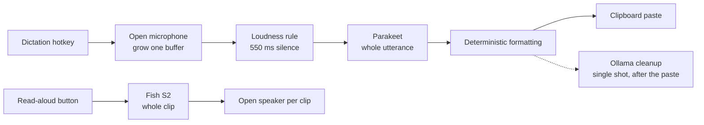
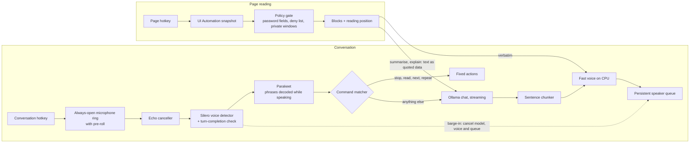

# Voice Assistant Plan

Audit, research and roadmap for adding a hands-free conversation mode and screen-aware
reading to LocalFlow. Written 2026-11-22. Dictation stays as it is; everything here is
additive.

Every number is labelled **measured** (on this workstation: Core Ultra 7 165H, RTX 4070
Laptop 8 GB, Windows 11), **published** (by a vendor or paper) or **estimate**. Estimates are
not targets met; they are what the first benchmark has to confirm or correct.

## Decisions

Taken by the project owner on 2026-11-22:

| Question                      | Decision                                                                                                                                                      |
| ----------------------------- | ------------------------------------------------------------------------------------------------------------------------------------------------------------- |
| Relation to dictation         | Conversation is a second mode. Push-to-talk dictation is unchanged.                                                                                           |
| Cloud                         | None. Speech recognition, the language model and voices all run locally.                                                                                      |
| Where page content comes from | A global hotkey over whatever window is focused, read through Windows UI Automation. No browser extension. Screenshots only as an opt-in fallback for charts. |
| Voices                        | A fast lightweight voice for conversation and, by default, for reading pages. Fish S2 Pro stays as an opt-in high-quality read-aloud voice.                   |
| Starting and stopping         | A hotkey toggles hands-free conversation. The same hotkey ends it.                                                                                            |
| Tools                         | The language model gets none. Every action comes from a hotkey or a fixed match on the user's own speech.                                                     |
| Privacy document              | `PRIVACY.md` will change when page reading ships: window text is read only on the user's hotkey, and screenshots are a separate opt-in.                       |

## Where the code stands

Dictation is sound: a stale or cancelled session never pastes, the paste fails closed when
focus moved, and logs carry no transcript text. Its real-time parts are each built around one
complete utterance, so conversation needs new plumbing rather than tuning.

| Area                                          | State                                                                                                                                                      | Evidence                                                                        |
| --------------------------------------------- | ---------------------------------------------------------------------------------------------------------------------------------------------------------- | ------------------------------------------------------------------------------- |
| Speech recognition                            | Reusable. Provider trait, in-process Parakeet, fallback chain, deadlines.                                                                                  | `src-tauri/src/asr/provider.rs`, `transcribe_cpp.rs`, `engine_select.rs`        |
| Microphone capture                            | Rework. Opened per recording; the callback allocates and locks; one growing buffer capped at 120 s.                                                        | `src-tauri/src/audio/capture.rs`, `native_dictation/mod.rs` (`start_recording`) |
| Voice detection                               | Rework. Fixed loudness thresholds polled on wall-clock time.                                                                                               | `src-tauri/src/audio/vad.rs`                                                    |
| Playback                                      | Rework. One finished clip per call, a new output stream each time, no streaming, no fade on stop.                                                          | `src-tauri/src/tts/playback.rs`                                                 |
| Language model client                         | Rework. Non-streaming JSON cleanup only; no chat history, no cancellation.                                                                                 | `src-tauri/src/llm/ollama.rs`, `cleanup.rs`                                     |
| Cancellation                                  | Rework. A superseded job is discarded when it finishes, not stopped. Read-aloud cannot stop synthesis.                                                     | `asr/provider.rs` (`transcribe`), `tts/mod.rs` (`stop`)                         |
| Turn-taking, echo handling, a real-time voice | Missing.                                                                                                                                                   |                                                                                 |
| Reading other windows                         | Missing. `context` holds an empty provider; no UI Automation features are enabled.                                                                         | `src-tauri/src/context/mod.rs`, `Cargo.toml`                                    |
| Streaming scaffolding                         | Unused. `asr/streaming.rs`, `stabilizer.rs` and `windows.rs` are test-only. `transcribe-cpp` 0.4.2 ships its own streaming and Silero voice-detection API. |                                                                                 |

## Target design

Rust owns the whole pipeline; React shows state and settings. The stages are a cascade
(speech recognition, then a text model, then a voice) rather than one speech-to-speech model:
none of those fits 8 GB of shared GPU memory, runs natively on Windows and can read text
verbatim. Nothing leaves the process except loopback calls to Ollama, so there is no
WebSocket or WebRTC transport to choose.

Two structural rules carry the safety properties:

- **Verbatim reading never touches the language model.** The read path takes extracted text
  straight to the voice, and its handler has no model in its signature.
- **Page text is data.** It reaches the model only for summarise and explain, wrapped as
  quoted content, and the model's output goes only to speech and the overlay.

## Technology choices

| Piece              | Choice                                              | Fallback                                                 | Cost                          | Basis                                                                             |
| ------------------ | --------------------------------------------------- | -------------------------------------------------------- | ----------------------------- | --------------------------------------------------------------------------------- |
| Speech recognition | Keep Parakeet TDT 0.6B v3, decoded phrase by phrase | Nemotron Speech Streaming EN 0.6B (539 MB, English only) | none                          | 0.93 % WER, 534 ms median per utterance: measured (`benchmarks/ASR_BENCHMARK.md`) |
| End of speech      | Silero VAD through `transcribe-cpp`                 | today's loudness rule                                    | about 1 MB                    | published                                                                         |
| End of turn        | Pipecat Smart Turn v3 (later milestone)             | Silero with a longer wait                                | about 30 MB with ONNX Runtime | published; untested here                                                          |
| Language model     | `llama3.2:3b`                                       | evaluate `qwen3.5:4b`                                    | none                          | measured, below                                                                   |
| Conversation voice | Gradium Phonon 31m on CPU, streaming                | Kokoro-82M                                               | about 70 MB, no GPU memory    | published; one month old, unmeasured on this class of CPU                         |
| Read-aloud voice   | the fast voice by default; Fish S2 Pro opt-in       |                                                          | none                          | Fish: measured, below                                                             |
| Interrupting       | hotkey first; then speech, with echo cancellation   | hotkey only on speakers                                  | none                          | estimate                                                                          |
| Reading windows    | `windows` crate UI Automation on a dedicated thread |                                                          | none                          | published                                                                         |

Rejected, with the reason: speech-to-speech models (memory, Windows support, no verbatim
reading); cloud speech or voices (project policy); a browser extension (owner decision; it
could later implement the same page-context interface); TEN VAD (licence restricts competing
uses); Whisper streaming (30-second encoder window is too slow on CPU).

## Baselines and targets

Language model, measured 2026-11-22 against local Ollama with short spoken-style replies,
model warm, `num_ctx` 2048:

| Model                                          | First token | First full sentence | Speed             |
| ---------------------------------------------- | ----------- | ------------------- | ----------------- |
| `llama3.2:3b`                                  | 40-53 ms    | 285-482 ms          | 78-100 tokens/s   |
| `gemma4:12b-it-qat`, thinking off              | 510-727 ms  | 1.3-1.6 s           | 12-15 tokens/s    |
| `gemma4:12b-it-qat`, thinking on (its default) | 20-38 s     | 21-40 s             | about 12 tokens/s |

Gemma 12B ran 28 % on CPU because it does not fit the GPU, before any voice model is loaded.
Asking for a different context size than the loaded copy has costs a reload: about 10 s for
`llama3.2:3b` in this test. Every caller must use the same `num_ctx` (`OLLAMA_NUM_CTX` in
`llm/ollama.rs`).

Pipeline:

| Stage                            | Today                                               | Target                             | Basis                                     |
| -------------------------------- | --------------------------------------------------- | ---------------------------------- | ----------------------------------------- |
| End of speech to final text      | about 0.9 s short turns, 1.7 s long                 | about 0.5 s                        | today: measured parts; target: estimate   |
| Model, first sentence            | 0.29-0.48 s                                         | same                               | measured                                  |
| Voice, first audio               | no real-time voice exists                           | 0.1-0.2 s                          | estimate from published figures           |
| End of speech to hearing a reply | not possible                                        | about 1.0-1.2 s, later under 0.8 s | estimate                                  |
| Interrupt to silence             | not possible                                        | about 0.3 s                        | estimate                                  |
| Fish S2 Pro read-aloud           | 2.8 times slower than real time on CUDA, 35 s start | unchanged                          | measured (`development/PLAN.md` slice 17) |

At that speed Fish needs about 108 s of generation before a one-minute passage can play
without gaps. No smaller model keeps its voice. That is why the fast voice reads pages by
default.

## Measured after milestone 2

The first version of conversation mode exists and was measured end to end with real
models and stand-in devices (`benchmarks/CONVERSATION_BENCHMARK.md`). Median time from the
end of the user's speech to the first audio of the reply: 1,090 ms (slowest 1,859 ms).
The estimates in the table above held for the voice (63-147 ms to first audio) and the
model (46-82 ms typical) and were optimistic for the rest: the 700 ms silence wait and
282-943 ms of transcription are now most of the delay.

Two things the research did not predict, both found by measuring:

- The voice library defaults to one thread per logical core, which on this 22-thread CPU
  made it 4 times slower than giving it four threads.
- The laptop GPU drops to its lowest power state within the few seconds a user is
  speaking, and the next request then waits up to a second. Small keep-warm requests
  while the user speaks removed most of that.

Not yet measured: a person at a real microphone and speaker, and how the voice sounds.

## Roadmap

1. **Foundations (done, see `development/PLAN.md` slice 19).** No behaviour change: settings
   that survive new fields, the dictation monolith split into shared modules, a content
   security policy and per-window permissions, clipboard tidy-up, a CI job.
2. **Conversation, first version (done, see `development/PLAN.md` slice 20).** Always-open capture with a visible indicator and hard
   time limits, Silero, a streaming cancellable chat client, the fast voice, a persistent
   playback queue, and a pure turn-taking state machine tested with scripted fakes. Interrupt
   by hotkey. Includes the end-to-end latency benchmark that replaces the estimates above.
3. **Read this page (done, see `development/PLAN.md` slice 21).** UI Automation snapshot, the policy gate, verbatim reading with next
   and back, chunked read-aloud, and the `PRIVACY.md` change. No language model involved.
4. **Natural turn-taking.** Turn-completion model, decoding while the user speaks, spoken
   barge-in with echo cancellation, automatic fallback to hotkey interrupt.
5. **Summarise, explain, what changed.** Page text passed to the model as quoted data, a
   snapshot diff kept in memory only, and a fixture corpus of malicious pages.
6. **Charts and release hardening.** Screenshot plus local vision as an opt-in, integrity
   checks on bundled binaries, a release log file, an installer smoke test.

## Known risks

| Risk                                                  | Plan                                                                                                                                                                                   |
| ----------------------------------------------------- | -------------------------------------------------------------------------------------------------------------------------------------------------------------------------------------- |
| The microphone hears the assistant on laptop speakers | Start with hotkey interrupt. Add echo cancellation, a stricter speech gate while speaking, and a transcript check against what is being spoken. Keep hotkey interrupt as the fallback. |
| Phonon is new and unmeasured on this CPU              | Benchmark first; Kokoro is the fallback behind the same trait.                                                                                                                         |
| Extraction quality without the DOM                    | Near parity expected on pages with a main landmark; worse on unstructured pages. Measure on saved fixtures of real pages.                                                              |
| Google Docs, PDFs and elevated windows expose little  | Report "cannot read this window" plainly; never fall back to a screenshot silently.                                                                                                    |
| Ollama serves one request at a time                   | Cancel the reply on interruption by closing the connection; verify that generation stops.                                                                                              |
| An in-process speech engine crash ends the app        | Accepted for now; longer sessions raise the exposure. Revisit with a watchdog relaunch.                                                                                                |
| A malicious page skews a summary                      | The model has no tools and its output is only spoken, with an audible "summary" label. Tested against the fixture corpus.                                                              |

## Still open before a wider release

Found by the audit and not addressed in milestone 1:

- Release builds honour `LOCALFLOW_WHISPER_*` overrides and a development path baked in at
  compile time, and launch sidecars without an integrity check.
- A model path saved in settings is checked only for existence before being parsed in-process.
- Release builds have no log file or crash marker; a failed settings save falls back silently
  in the web UI.
- Ollama is trusted by port number alone.
- Model downloads are verified by size, not hash.
- The privacy and microphone settings shown in the UI are not read by the native path.
